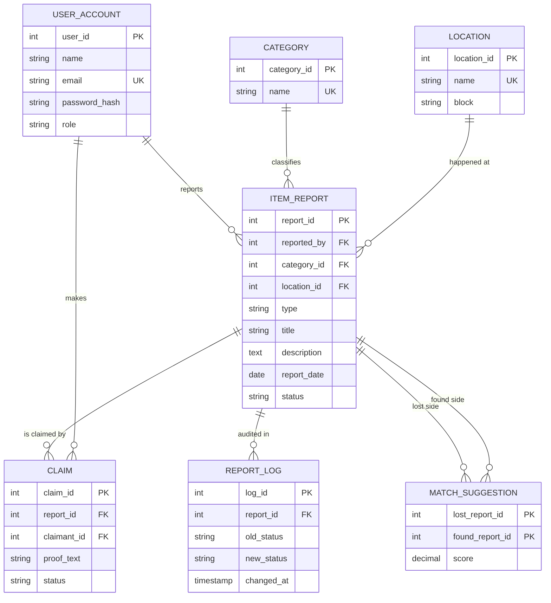

# FoundIt - Campus Lost-and-Found Portal
DBMS Experiential Learning - Level 3 Project
Team: Harshith (PES1UG24AM370) and <teammate name / SRN>

## 1. Problem statement
Lost items on campus are reported through messaging groups or at a security desk. Owners rarely
find their belongings, and nobody can prove who collected what. FoundIt gives students one place to
report lost and found items, suggests likely matches automatically, and verifies ownership before handover.

## 2. Objectives
- Report lost and found items with category, location and date.
- Suggest matches between lost and found reports.
- Verify ownership through a claim, staff approval and a one-time code.
- Keep an audit trail of every status change.
- Give staff and admins a dashboard of open items and recovery rates.

## 3. Scope
Single campus, text reports only (no image recognition), web application only.
Out of scope: mobile app, email/SMS notifications, image matching.

## 4. Functional requirements
| ID | Requirement | Role |
|---|---|---|
| F1 | Register, log in, log out (session expires after 1 hour) | All |
| F2 | Create a LOST or FOUND report | Student, Staff, Admin |
| F3 | Search (full-text) and filter items by type, status, category | All |
| F4 | View item detail, suggested matches and status history | All |
| F5 | Claim a FOUND item with proof of ownership | Student |
| F6 | Approve or reject claims | Staff, Admin |
| F7 | Hand over an item after OTP verification | Staff, Admin |
| F8 | View dashboard: counts, recovery rate, busiest locations, top finders | Staff, Admin |

## 5. ER diagram


## 6. Relational schema
```
USER_ACCOUNT(user_id PK, name, email UNIQUE, phone, password_hash, role, created_at)
CATEGORY(category_id PK, name UNIQUE)
LOCATION(location_id PK, name UNIQUE, block)
ITEM_REPORT(report_id PK, reported_by FK->USER_ACCOUNT, category_id FK->CATEGORY,
            location_id FK->LOCATION, type, title, description, report_date, status, created_at, image_note)
CLAIM(claim_id PK, report_id FK->ITEM_REPORT, claimant_id FK->USER_ACCOUNT, proof_text, status,
      created_at, UNIQUE(report_id, claimant_id))
MATCH_SUGGESTION(lost_report_id FK, found_report_id FK, score, PK(lost_report_id, found_report_id))
REPORT_LOG(log_id PK, report_id FK->ITEM_REPORT, old_status, new_status, changed_at)
```
Normalisation: every table is in 3NF. Category and location are separate tables so names are stored once;
the many-to-many "match" between lost and found reports is resolved by MATCH_SUGGESTION.

## 7. Database choice and justification
| Data | Database | Why |
|---|---|---|
| Users, reports, claims, logs | **MySQL** | Strong relationships, constraints, joins, transactions and a full-text index. Data must be permanent and consistent. |
| Sessions, OTPs, login attempts | **Redis String + expiry** | Short-lived; Redis deletes them automatically. |
| Recent activity feed | **Redis List** | Newest-first, capped at 20 with LTRIM. |
| Dashboard counts | **Redis Hash** (60 s cache) | Avoids recomputing the same counts on every dashboard load. |
| Top finders | **Redis Sorted Set** | Ranking by score is its built-in behaviour. |
Vector search was not used: matching text is short and keyword-based, so full-text search is sufficient and simpler.

## 8. Data dictionary
(See `database/schema.sql`; every column has a type, NOT NULL / UNIQUE / CHECK rules.)
Key rules: `role IN (Student, Staff, Admin)`, `type IN (LOST, FOUND)`, `status IN (OPEN, CLAIMED, CLOSED)`,
claim `status IN (PENDING, APPROVED, REJECTED)`, one claim per student per item, report date cannot be in the future.

Redis keys: `session:<token>` (String, 1 h), `otp:claim:<id>` (String, 24 h), `login:fail:<email>` (counter, 5 min),
`feed:recent` (List), `stats:dashboard` (Hash, 60 s), `leaderboard:finders` (Sorted Set).

## 9. Database implementation
- **DDL:** CREATE (7 tables), ALTER (add `phone`, `image_note`), DROP (scratch table), indexes `idx_item_status`,
  `idx_item_category`, FULLTEXT `ft_item_text`.
- **Views:** `v_open_items`, `v_recovery_by_category`.
- **Triggers:** future-date check; audit log on insert and status update; claim rules (FOUND items only, OPEN only, not your own).
- **Stored procedures:** `approve_claim` (transaction with ROLLBACK handler), `suggest_matches` (full-text + category/location bonus).
- **Advanced concepts demonstrated (need 4):** transactions, views, stored procedures, triggers, indexing, full-text search.

## 10. Important queries
See `database/queries.sql` (join, GROUP BY/HAVING, subquery, full-text, aggregate, DML, procedure calls).

## 11. System architecture
Browser -> Next.js pages (React) -> Next.js Route Handlers (`/api/*`) -> MySQL (permanent data) and Redis (sessions, cache, queues).
Credentials come from environment variables; passwords are bcrypt hashes; all queries are parameterised.

## 12. Application screenshots
<Add screenshots: login, items list with search, report form, item detail with matches, claim queue, my claims with OTP, dashboard.>

## 13. Testing results
| # | Test | Expected | Result |
|---|---|---|---|
| T1 | Register with short password | Rejected | |
| T2 | Login with wrong password 6 times | 6th blocked (429) | |
| T3 | Report with future date | Rejected by trigger | |
| T4 | Claim own report | Rejected by trigger | |
| T5 | Claim same item twice | Rejected (UNIQUE) | |
| T6 | Student opens /api/stats | 403 | |
| T7 | Approve one of two pending claims | Other claim becomes REJECTED, item CLAIMED | |
| T8 | Handover with wrong OTP | Rejected | |
| T9 | Handover with correct OTP | Item CLOSED, finder +1 on leaderboard | |
| T10 | Search "black wallet" | Wallet items ranked first | |

## 14. Conclusion and future enhancements
FoundIt combines relational integrity (constraints, triggers, transactions) with Redis for speed-sensitive data.
Future work: image upload and visual matching with a vector database, email/SMS notifications, admin screens to manage categories.
